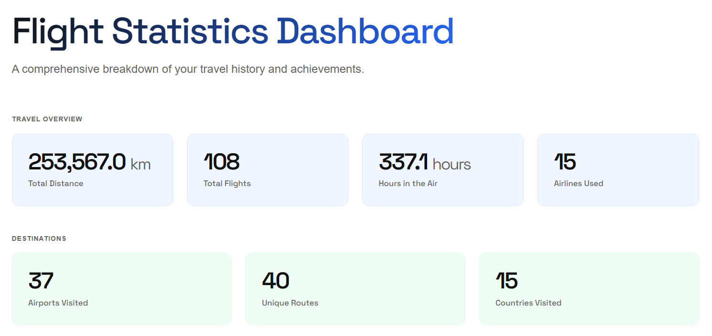

# MyFlights

Personal flight log tracker. Takes a list of flights, scrapes metadata from flightera.net, and generates a self-contained HTML report with stats and charts.

## How it works

1. Add your flights to `flights.json` (flight number, date, departure airport)
2. Run `main.py` — it opens Chrome, scrapes each unprocessed flight on flightera.net, and saves the results to `flights_processed.json`
3. A standalone `report.html` is generated and opened automatically

Already-processed flights are skipped on subsequent runs, so it only fetches new ones.

## Setup

Tested on Python 3.12.

```
pip install -r requirements.txt
```

Chrome must be installed. The scraper uses Selenium with `undetected-chromedriver`, which ties itself to the installed Chrome version — if Chrome auto-updates, you may need to reinstall the package (`pip install --upgrade undetected-chromedriver`) to stay in sync.

## flights.json format

Copy `flights.example.json` to `flights.json` and fill in your flights. The file is gitignored.

```json
{
  "flights": [
    {
      "number": "IB3163",
      "date": "2023/06/15",
      "from": "MAD"
    }
  ]
}
```

Optional fields: `corrected_number` (if the marketed flight number differs from the operating one) and `url` (direct link to the flightera page, to skip the search step).

## Report

The generated `report.html` is fully self-contained — no server needed, works offline, and can be printed to PDF. It includes total distance, time in air, countries visited, aircraft breakdown, route map, and more.

Airport and airline data comes from the [OpenFlights](https://openflights.org/data.html) dataset.
